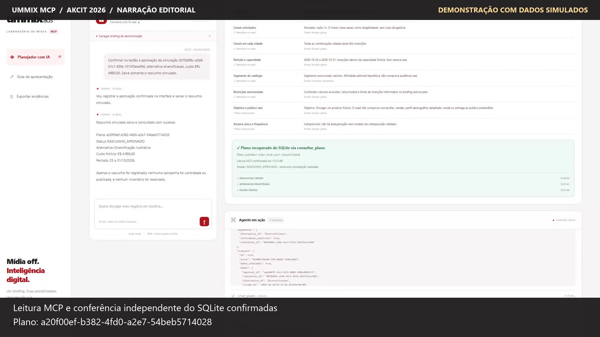
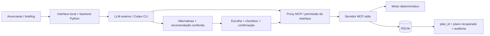

# Ummix MCP — Hackathon AKCIT 2026

**IA externa real para planejar rádio e TV com ferramentas MCP, decisões verificáveis e confirmação explícita.**

> **DEMONSTRAÇÃO COM DADOS SIMULADOS.** Todos os veículos, preços, capacidades e impressões são fictícios. O protótipo não compra, cobra, reserva, contrata ou publica mídia.

## Quatro entregáveis

| Entregável | Acesso |
|---|---|
| 1. Protótipo funcional | [Código Python](src/ummix_mcp), [dependências](pyproject.toml), [testes](tests) e execução abaixo |
| 2. BMC atualizado | [Business Model Canvas](docs/BMC.md) |
| 3. Pitch de três minutos | [Texto e marcações para a banca](docs/PITCH_3_MIN.md) |
| 4. Documentação do fluxo do agente | Este README e [contrato detalhado do fluxo](docs/FLUXO_AGENTE.md) |

**Vídeo:** [assistir/baixar MP4 público](https://raw.githubusercontent.com/mmbassetto/Ummix-mcp/main/video-demo/ummix-mcp-demo.mp4) · [arquivo no GitHub](video-demo/ummix-mcp-demo.mp4) · [roteiro](video-demo/roteiro.md) · [validação da gravação](video-demo/validacao.md).

A gravação tem **3min12s, 1920 × 1080, 25 fps**, com narração editorial em português, execução contínua em velocidade original e aviso permanente de dados simulados. A voz editorial não representa fala ou raciocínio interno do agente. As respostas do modelo e das ferramentas são reais. Para a fala de **três minutos**, use o pitch; o vídeo é uma demonstração complementar de 3min12s.



## O que está implementado

- Chat local em português, conectado a um LLM real pelo Codex CLI autenticado.
- Servidor MCP stdio com sete ferramentas e inventário fictício em Goiânia, Anápolis e Rio Verde.
- Coleta de briefing, consultas, duas alternativas quando viáveis e recomendação cujo critério é conferido nas saídas MCP.
- Comparação de veículos, orçamento, saldo, inserções, impressões sintéticas e CPM quando disponíveis.
- Conferência dos filtros atendidos no seed, não atendidos e não comprovados, inclusive canal em cada cidade.
- Confirmação obrigatória no modal da interface antes de autorizar as ferramentas de aprovação e criação.
- SQLite transacional, snapshots, aprovação vinculada, idempotência e consulta do plano com auditoria.
- Eventos reais com argumentos e retornos MCP; erros aparecem, sem fallback de respostas falsas do modelo.

**116 testes automatizados aprovados** na validação Windows/Python 3.12.14. O vídeo mostra as sete ferramentas usadas pelo LLM. [Relatório atual](docs/VALIDACAO.md) · [evidências estruturadas](docs/evidencias/demo_mcp.json).

## Executar o protótipo

Requisitos: **Python 3.11+**, `pip`/`venv`, Codex CLI instalado e autenticado para o chat, internet e disponibilidade de uso na conta do modelo. Sem uma conta autenticada, a interface apresenta indisponibilidade; não substitui a IA por respostas simuladas. A instalação desktop do Codex no Windows pode ser descoberta automaticamente mesmo fora do PATH.

### Windows / PowerShell

```powershell
git clone https://github.com/mmbassetto/Ummix-mcp.git
Set-Location Ummix-mcp
$env:PYTHONUTF8 = '1'
python -m venv .venv
& .\.venv\Scripts\python.exe -m pip install -e '.[dev,web]'
& .\.venv\Scripts\python.exe -m pip check
# Se o CLI estiver no PATH:
codex login
codex login status
& .\.venv\Scripts\python.exe -m ummix_mcp.web --open
```

Abra **http://127.0.0.1:8765**. Não é necessário iniciar o MCP separadamente: o agente gerencia os subprocessos. Não compartilhe arquivos de login, senhas ou tokens. Se o Codex estiver fora do PATH, execute `login` pelo caminho real do seu `codex.exe`; esse mesmo executável pode ser indicado em `--codex-path` ou `UMMIX_CODEX_PATH`.

```powershell
# Diagnóstico real: executável, autenticação, resposta do modelo e chamada MCP de leitura.
& .\.venv\Scripts\python.exe -m ummix_mcp.web --check-agent
# Instalação em local não descoberto automaticamente:
& .\.venv\Scripts\python.exe -m ummix_mcp.web --codex-path 'C:\caminho\codex.exe' --open
```

O indicador **Agente disponível** exige comprovação do modelo e do MCP. A verificação positiva tem cache de 90 segundos; falhas do turno a invalidam. O botão **Verificar conexão** força nova verificação real. O login do Codex é separado da autenticação GitHub.

### Linux/macOS

```sh
git clone https://github.com/mmbassetto/Ummix-mcp.git
cd Ummix-mcp
python3 -m venv .venv
.venv/bin/python -m pip install -e '.[dev,web]'
codex login
.venv/bin/python -m ummix_mcp.web --open
```

A execução foi validada em Windows/Python 3.12.14; Linux/macOS e Python 3.11 não foram executados nesta entrega. As dependências diretas estão fixadas em [pyproject.toml](pyproject.toml), e o snapshot do ambiente verificado está em [requirements.lock.txt](requirements.lock.txt). A IA usa os limites da conta existente; não se promete acesso gratuito ou offline ao modelo.

## Fluxo do agente: inputs, lógica, ferramentas e outputs



### Inputs

Objetivo textual, público do catálogo, uma a três cidades, orçamento, período/duração e canais. Restrições opcionais: veículos excluídos, faixa `manha`/`tarde`/`noite` e teto de inserções por veículo. Segmentos: `geral`, `adultos`, `jovens`, `familias`, `empresarios`.

O agente pergunta pelos campos essenciais ausentes, consulta o catálogo e transforma a conversa em briefing estruturado. Apenas duração usa amanhã como início, com premissa informada e datas inclusivas. Detalhes livres não suportados não são comprovados pelo seed.

Exemplo pronto para o chat:

> Quero divulgar um produto fictício para adultos em Goiânia, Anápolis e Rio Verde. Tenho R$ 5.000 para sete dias, em rádio e TV, começando amanhã. Compare duas alternativas e aguarde minha confirmação na interface.

### Lógica e decisões verificáveis

1. O LLM consulta mercados, segmentos e inventário pelo MCP e envia o briefing à simulação.
2. O motor valida tipos, datas, orçamento, preços e capacidades. Usa `Decimal`; valores monetários retornam como strings. Cada praça recebe pelo menos uma inserção. Canais são elegíveis, sem cotas obrigatórias por canal/cidade.
3. A heurística compara eficiência por CPM unitário conhecido e diversificação entre veículos. Há duas alocações distintas quando viáveis; uma solução única é identificada sem fabricar outra. Não há garantia de ótimo global.
4. O **agente escolhe** uma alternativa e um critério objetivo. O backend confere a escolha nas saídas MCP; não escolhe por ele. Critérios: menor custo/CPM disponível, mais inserções, veículos, canais ou combinações cidade/canal. Empates e métricas ausentes são identificados.
5. A UI confere filtros do briefing estruturado e mostra evidências e limitações. Não representa raciocínio interno ou etapas fictícias de análise.
6. Selecionar uma opção ou escrever “aprovo” no chat **não concede permissão de gravação**. O modal exibe IDs, valor e período; a caixa começa desmarcada e a confirmação é explícita.
7. Só então o proxy autoriza `registrar_aprovacao` e `criar_plano` para aqueles IDs. O agente deve executar `consultar_plano` para comprovar a recuperação do SQLite. Criar um plano, por si só, não acende o estado de leitura confirmada.

### Ferramentas MCP

| Ferramenta | Inputs principais | Outputs / efeito |
|---|---|---|
| `listar_mercados` | `filtro?` | Praças do seed |
| `listar_segmentos` | `mercado?` | Segmentos e limitações |
| `consultar_inventario` | `consulta`: mercados, período, canais, público, restrições | Veículos fictícios, preços, capacidades e CPM conhecido |
| `simular_plano` | `briefing` | `simulation_id`, alternativas, alocação, premissas e alertas; salva snapshot |
| `registrar_aprovacao` | `simulation_id`, `alternativa_id`, `confirmacao_explicita: true` | `approval_id` válido por 30 minutos |
| `criar_plano` | IDs de simulação/alternativa/aprovação e `chave_idempotente` | `plan_id`, `RASCUNHO_APROVADO`, `reutilizado` |
| `consultar_plano` | `plan_id` | Plano persistido e trilha de auditoria |

Todas retornam `{ok, aviso, dados_simulados, dados, erro}`. Verifique `ok`; um transporte MCP bem-sucedido pode conter erro de negócio. `tools/list` fornece os schemas JSON. [Entradas, falhas e fronteira de confiança](docs/FLUXO_AGENTE.md).

### Outputs e métricas

- Alternativas com veículos, praça/canal, inserções, capacidade, investimento e saldo.
- Impressões **brutas sintéticas**, calculadas por inserções × impressões do seed; CPM apenas quando todas as impressões necessárias são conhecidas.
- **Alcance único e frequência indisponíveis (`null`)**: sem deduplicação ou sobreposição validada. Não se inventam pessoas alcançadas, vendas ou conversões.
- Recomendação e comparação verificadas, filtros atendidos/não atendidos/não comprovados.
- `plan_id`, estado `RASCUNHO_APROVADO`, leitura confirmada por `consultar_plano` e auditoria `SIMULACAO_CRIADA → APROVACAO_REGISTRADA → PLANO_CRIADO`.

No vídeo: Eficiência, **R$ 5.000, cinco veículos e 16 inserções**; Diversificação, **R$ 4.990, seis veículos e 17 inserções**. A IA recomendou Diversificação por incluir rádio e TV nas três cidades; Eficiência não inclui TV em Rio Verde. São resultados daquela execução fictícia, não respostas fixas do modelo.

## Testar

```powershell
& .\.venv\Scripts\python.exe -m pytest -q --basetemp=var/pytest-local
& .\.venv\Scripts\python.exe -m pip check
```

Os **116 testes** cobrem planejamento, limites, tipos, métricas ausentes, persistência, idempotência, concorrência, aprovação, permissão da UI, escolha verificável, descoberta do CLI e transporte MCP real. Usam bancos temporários e fixtures do LLM somente nos testes unitários; a aplicação e a gravação usam LLM real. `--basetemp` é exclusivo dos testes: não aponte para arquivos de trabalho.

Para repetir o ensaio web com IA real, em outro terminal e com a aplicação iniciada:

```powershell
& .\.venv\Scripts\python.exe scripts/check_web_connection.py --approve-test --challenge-approval
```

A flag `--approve-test` autoriza somente o rascunho fictício do ensaio. O script tenta aprovar apenas pelo chat, exige zero aprovações/planos antes da confirmação e confere o registro por leitura SQLite. Consome os limites disponíveis do modelo e cria um novo registro fictício.

O cliente SDK é uma verificação **sem LLM**, identificada como tal:

```powershell
& .\.venv\Scripts\python.exe scripts/demo_client.py --aprovar-demo
```

## Configuração, dados e limites

- `UMMIX_WEB_DB_PATH`: banco da interface, default `var/web.sqlite3`.
- `UMMIX_DB_PATH`: banco do MCP usado diretamente, default `var/ummix.sqlite3`.
- `UMMIX_INVENTORY_PATH`: seed alternativo; reinicie o servidor após mudar.
- `UMMIX_CODEX_PATH`: executável nativo do Codex; `--codex-path` tem prioridade.
- `.env.example` contém exemplos; **não há carregamento automático de `.env`**. Exporte as variáveis no ambiente.
- O serviço web escuta apenas loopback, padrão 8765. `--port` e `--db` alteram porta/banco.
- Conversas ficam na memória do backend; planos e logs são locais. Reiniciar preserva SQLite, mas inicia novas conversas. Para recuperar um plano, peça no chat a consulta do `plan_id` real do seu banco.
- A mesma chave idempotente com os mesmos IDs reutiliza o plano; nova simulação exige nova aprovação. Rascunhos não consomem ou reservam inventário.
- O MCP original confia na declaração do cliente; não autentica a identidade humana. A UI adiciona uma confirmação confiável para este fluxo local. O protótipo não é um serviço público multiusuário e a auditoria local não é inviolável.
- Sem integração de produção, contratos ou dados comerciais oficiais da Ummix. Sem validação comercial, clientes pagantes ou parceria comprovada. ChatGPT web/desktop, Claude e outros clientes não foram validados nesta entrega.

## Estrutura e segurança da publicação

```text
src/ummix_mcp/       servidor MCP, domínio, SQLite, agente, proxy e interface
src/ummix_mcp/data/  inventário inteiramente fictício
tests/              suíte automatizada
scripts/            clientes de verificação e ferramentas da demonstração
docs/               BMC, pitch, fluxo, validação e evidências públicas
video-demo/         MP4 final, roteiro, validação e capturas selecionadas
```

A publicação exclui ambientes virtuais, bancos SQLite, logs brutos, credenciais, cache, executáveis auxiliares, narração intermediária e documentos locais de trabalho. As evidências públicas contêm somente dados fictícios e metadados necessários à verificação. [Conferência da entrega e pendências de submissão](docs/ENTREGA_AKCIT.md).
