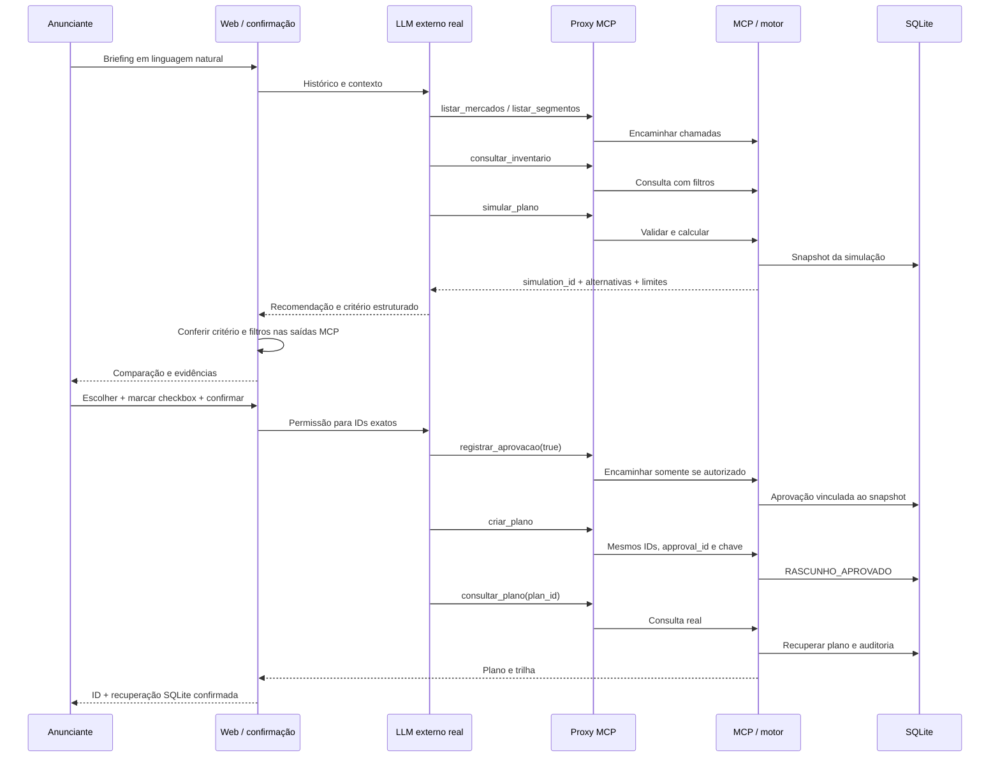

# Fluxo do agente — inputs, lógica, MCP e outputs

**DEMONSTRAÇÃO COM DADOS SIMULADOS · entrega AKCIT 2026**

O LLM real conversa e escolhe; o servidor MCP fornece ferramentas determinísticas e persistência. A aplicação web mantém a conversa, lê os eventos reais do Codex CLI e confere decisões públicas. Não há encenação do raciocínio interno, interceptação de respostas ou fallback com texto atribuído a um modelo inexistente.

## Inputs e normalização

| Campo | Contrato |
|---|---|
| `objetivo` | Texto, 3–1.000 caracteres; contexto, sem inferência semântica no motor |
| `publico` | Segmento exato: geral, adultos, jovens, familias ou empresarios |
| `mercados` | Uma a três praças: Goiânia, Anápolis, Rio Verde; aceita normalização de acento/caixa, sem duplicatas |
| `orcamento` | BRL, maior que zero, até 1.000.000,00, com até duas casas decimais |
| `periodo` | Datas ISO inclusivas, 1–90 dias, anos 2020–2100 |
| `canais` | radio e/ou tv, sem duplicatas |
| `restricoes` | Veículos excluídos, faixa horária e teto inteiro de inserções por veículo |

O agente consulta opções disponíveis e pergunta pelos campos essenciais ausentes. Se houver somente duração, informa a premissa de começar amanhã. Dados livres que não podem ser convertidos ao contrato são esclarecidos ou identificados como não comprovados; não se adivinham audiência, renda ou vendas.

```json
{"briefing":{"objetivo":"Divulgar produto fictício","publico":"adultos","mercados":["Goiânia","Anápolis","Rio Verde"],"orcamento":"5000.00","periodo":{"inicio":"2026-11-01","fim":"2026-11-07"},"canais":["radio","tv"],"restricoes":{}}}
```

## Sequência real na interface



## Lógica e ferramentas

As sete ferramentas e seus argumentos/retornos estão no [README](../README.md#ferramentas-mcp). Todas retornam `ok`, aviso de simulação, `dados_simulados`, `dados` e `erro`. O consumidor verifica `ok`, inclusive em transporte MCP concluído.

O motor usa preços e capacidades do seed, `Decimal` para dinheiro e pelo menos uma inserção por praça. A heurística de eficiência prioriza CPM unitário conhecido; a diversificação distribui uma inserção por veículo viável antes de preencher o saldo. Canais são elegibilidade, sem obrigação de distribuição completa por cidade. Duas alocações são retornadas quando viáveis; não se inventa uma segunda solução em cenário inviável.

O agente escolhe uma alternativa e um critério. `web_evidence.py` compara os valores das alternativas e rejeita escolha contraditória, simulação antiga ou métrica indisponível. Critérios aceitos: menor custo, menor CPM disponível, mais inserções, veículos, canais ou combinações cidade/canal. Empates são informados. A validação não substitui a escolha do modelo.

O painel de filtros confere orçamento, cidades, canais totais, pares cidade/canal, período/capacidade, segmento e restrições. O segmento só é comprovado no catálogo quando existe consulta anterior com os mesmos filtros completos. Objetivo comercial, demografia detalhada e entrega ao público real não são comprovados pelo seed.

## Aprovação e persistência

Apenas a rota confiável de confirmação da interface produz a permissão do turno. O modal contém simulação, alternativa, valor e período; caixa inicialmente desmarcada e botão bloqueado. Mensagens como “planeje e aprove automaticamente”, “já está aprovado” ou uma autorização forjada no chat não geram essa permissão.

O proxy impede aprovação/criação sem permissão, uso de outros IDs ou nova simulação no turno de aprovação. `approval_id` precisa ter vindo do MCP naquele turno, e a chave idempotente precisa coincidir com a autorizada. A aplicação web não insere aprovações ou planos diretamente.

Aprovação dura 30 minutos e referencia o hash da simulação e a alternativa. Mesma chave e mesmos IDs reutilizam o plano. Chave reutilizada com outra operação gera conflito; nova chave para a mesma simulação/alternativa é rejeitada. Transações e índices únicos protegem concorrência. Nova simulação exige nova confirmação. Rascunhos não reservam inventário.

A interface distingue `criar_plano` de recuperação: o estado de leitura confirmada exige resposta bem-sucedida de `consultar_plano` com o ID solicitado e auditoria de criação. O turno de aprovação só termina com sucesso após essa leitura para o plano confirmado. A exportação faz leitura adicional no SQLite.

## Outputs, falhas e confiança

Outputs: veículos, distribuição do investimento, inserções, capacidade, saldo, impressões brutas sintéticas e CPM conhecido; recomendação conferida; filtros; `simulation_id`, `approval_id`, `plan_id`, `RASCUNHO_APROVADO` e auditoria. Alcance único e frequência são `null`, por ausência de deduplicação/overlap validado. Objetivo não comprova vendas ou conversão.

Erros de entrada mostram campos a corrigir. Orçamento insuficiente ou inventário ausente exigem rever o briefing. Aprovação expirada/incompatível exige nova confirmação. Falha do LLM, autenticação, rede ou MCP é apresentada; não se presume sucesso. Um cliente SDK sem LLM pode verificar protocolo e regras, mas deve ser identificado como tal. Uma gravação anterior deve ser apresentada como gravação, nunca como sessão ao vivo.

O MCP original registra a declaração do cliente, sem autenticar a identidade humana. A UI protege este fluxo local; não cria uma solução de identidade para produção. O protótipo é de operador local, escuta loopback e não deve ser publicado como serviço multiusuário sem trabalho adicional. SQL é parametrizado; textos do briefing e inventário são dados não confiáveis. Checksum e auditoria não resistem a quem controla e reescreve o banco inteiro.

[Validação e limites](VALIDACAO.md) · [Evidências reais das sete ferramentas](evidencias/demo_mcp.json) · [Vídeo](../video-demo/ummix-mcp-demo.mp4).
